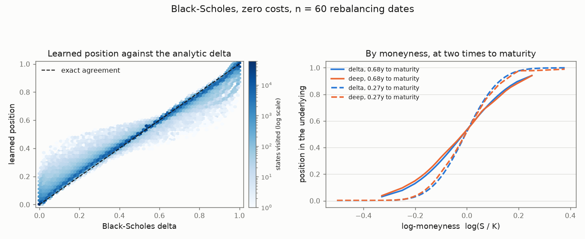
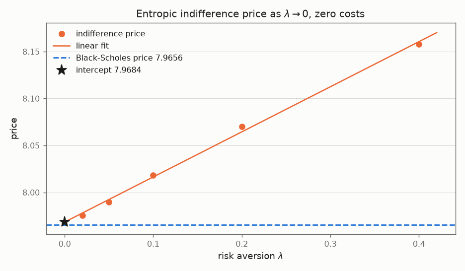
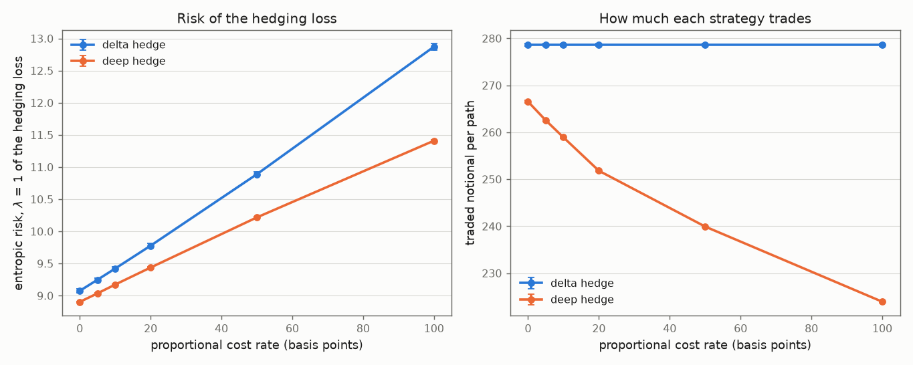
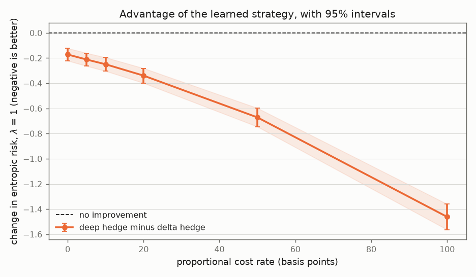
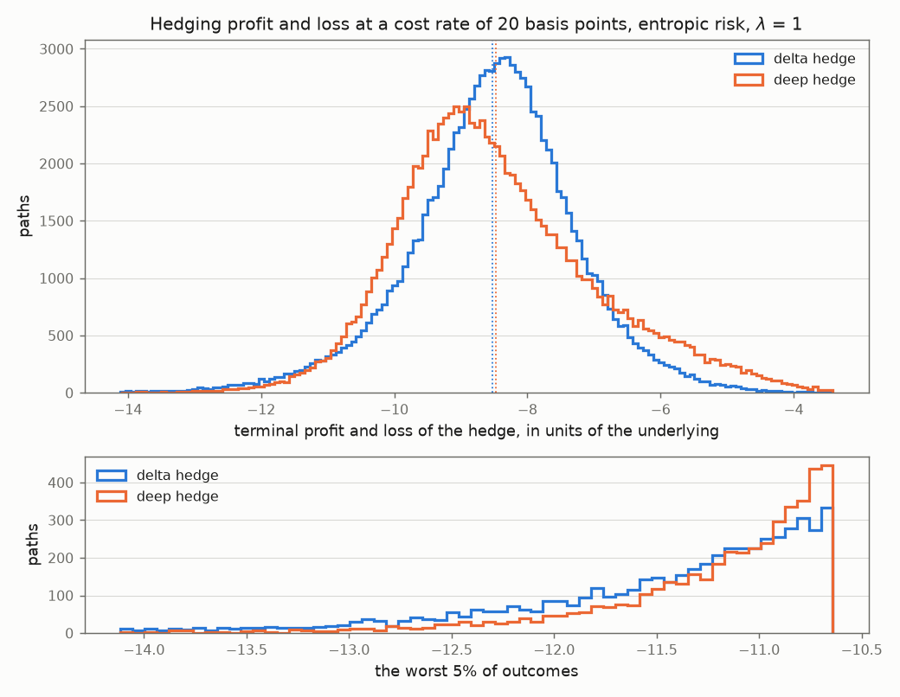
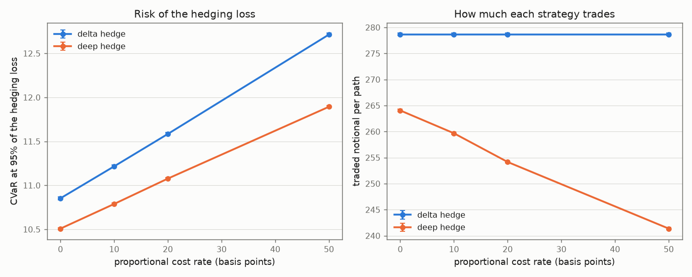
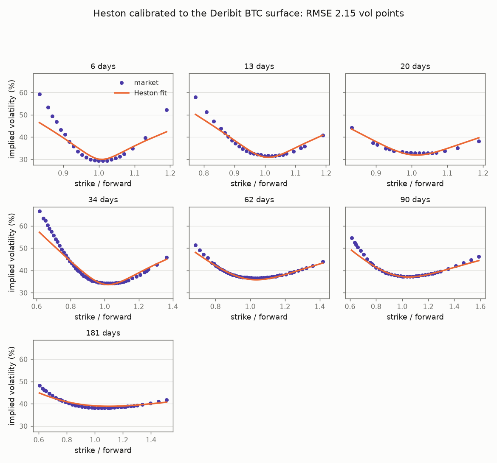

# Deep hedging under transaction costs

[](https://github.com/bkhmath/deep-hedging/actions/workflows/ci.yml)


A neural network hedges a European call by minimising a convex risk measure of the
terminal hedging loss, with proportional transaction costs inside the objective. The
setup follows Bühler, Gonon, Teichmann and Wood (2019), *Deep Hedging*, Quantitative
Finance 19(8), which I treat as the reference implementation. Every learned strategy is
measured against an analytic benchmark: Black-Scholes in closed form, and Heston through
a semi-analytic pricer calibrated to a real BTC option surface.

## Result

Under the entropic risk measure the learned strategy beats the Black-Scholes delta hedge
at every cost rate I tested, and it wins while trading less. One-year at-the-money call
worth 7.97, hedged 30 times:

| proportional cost | 0 bp | 5 bp | 10 bp | 20 bp | 50 bp | 100 bp |
|---|---|---|---|---|---|---|
| delta hedge, entropic risk | 9.075 | 9.247 | 9.422 | 9.777 | 10.888 | 12.871 |
| deep hedge | **8.903** | **9.036** | **9.173** | **9.438** | **10.217** | **11.410** |
| paired difference | -0.172 | -0.212 | -0.249 | -0.339 | -0.671 | **-1.462** |
| standard error | 0.025 | 0.026 | 0.027 | 0.030 | 0.038 | 0.052 |
| deep turnover (delta: 279 throughout) | 267 | 263 | 259 | 252 | 240 | 224 |

CVaR at 95% gives the same picture, with the advantage growing from 0.345 to 0.821 across
the same range.

One caveat up front, because it changes how the table should be read. The advantage at
zero cost is already 0.172, and that part has nothing to do with costs: at 30 rebalancing
dates the delta hedge is simply not the discrete-time optimum of the entropic measure.
Only the growth from 0.17 to 1.46 can be credited to putting costs in the objective.

## Why this project

In separate work I tested whether four intraday FX signals survive their own
transaction costs. None does.
The one signal with a real effect turns over 928 times a year and earns 0.022 pips
against a 0.35 pip half-spread, so it is short by a factor of sixteen.

This project takes the other side of the same question. If frictions cannot be avoided,
can the strategy be learned with the frictions included, instead of applying a
frictionless formula and paying for the mismatch? The Black-Scholes delta is derived in a
market where trading is free. Once trading costs money it solves the wrong problem: it
rebalances towards a target that was chosen without reference to what rebalancing costs.

The size of that mismatch can be shown before any network is involved. Without frictions,
rebalancing more often always helps, since the replication error falls like n^(-1/2). With
costs it stops helping, because the traded notional grows like sqrt(n):

```
turnover of the delta hedge  =  A + B sqrt(n),   R^2 = 0.99993
A = 102.4,  B = 31.95      n from 8 to 512, 50,000 paths each
```

The constant term is the part no schedule avoids: the hedge buys the initial delta once
and unwinds it once, which for this option is 2 x 0.54 x 100 = 108 of notional against a
fitted 102. Accuracy improves like n^(-1/2) while cost grows like n^(1/2), so the two
cross at a finite optimal frequency and hedging more often past that point is worse. Both
halves are tests: `test_the_error_decays_at_the_square_root_rate` and
`test_transaction_costs_destroy_the_benefit_of_rebalancing_more_often`.

## What is being optimised

Terminal wealth of a short call hedged with `n` rebalances, funded at zero initial cash:

```
PnL = -payoff(S_T) + sum_k delta_k (S_{k+1} - S_k) - c sum_k |delta_k - delta_{k-1}| S_k
```

with `delta_{-1} = 0` and `delta_n = 0`, so the initial purchase and the terminal
liquidation are both charged. Training minimises `rho(-PnL)` over the network weights for
a convex risk measure `rho`. There is no supervised target and the network never sees a
delta.

The state at date `k` is time to maturity, log-moneyness, the position currently held,
and the instantaneous volatility in the Heston case. The position has to be there. With
costs, moving from 0.4 to 0.6 and moving from 0.8 to 0.6 both cost something, so the best
action depends on where the portfolio already sits, and the problem is no longer Markov
in `(t, S)`.

Two risk measures:

- **Entropic**, `rho(X) = (1/lambda) log E[exp(lambda X)]`, computed with log-sum-exp.
  Written out directly, `exp` overflows in float32 above about 88 and in float64 above
  709. At initialisation the network holds nothing, so the loss is the raw payoff, and one
  bad path returns `inf` and then `NaN` gradients.
- **CVaR**, through the Rockafellar-Uryasev form
  `CVaR_a(X) = min_w { w + E[(X-w)^+]/(1-a) }`, with `w` optimised jointly with the
  weights by the same Adam step. The direct definition needs an empirical quantile, which
  is piecewise constant in the parameters and has zero gradient almost everywhere.

## Validation against known answers

A deep hedging study is only as good as the cases where the answer is known in advance.
All of the following are automated tests, not recorded outputs.

### 1. The network recovers the Black-Scholes delta

Frictionless and continuously rebalanced, the delta hedge replicates the call exactly.
The hedging loss is then identically zero, so the delta hedge minimises any convex risk
measure uniquely. The network is never told this.

| n | mean abs dev | median | p95 | p99 | max | learned risk | delta hedge risk |
|---|---|---|---|---|---|---|---|
| 15 | 0.0455 | 0.0393 | 0.1052 | 0.1608 | 0.2242 | 9.7645 +/- 0.0344 | 11.1696 +/- 0.1509 |
| 30 | 0.0257 | 0.0203 | 0.0625 | 0.1335 | 0.3415 | 8.8646 +/- 0.0097 | 9.0750 +/- 0.0282 |
| 60 | **0.0148** | 0.0110 | 0.0368 | 0.0948 | 0.3589 | 8.4352 +/- 0.0055 | 8.4525 +/- 0.0095 |

The deviation closes at rate n^(-0.81). This is the result I care most about: the network
reproduces a theorem it was never shown.



Two things do not look good and belong here anyway. The maximum deviation is 0.36 and
does not shrink with `n`. It sits in states the training paths almost never reach, far
out of the money and close to expiry, where the network gets no signal, so the agreement
holds over the sampled region and not over the whole state space. Separately, the output
layer is unconstrained, and the learned position overshoots the [0, 1] range a call delta
must lie in by a few per cent at the extreme. That overshoot does shrink with training
(1.36, then 1.07, then 1.10 across three configurations), so it looks like finite
optimisation and not a property of the optimum.

One check needs no tolerance at all. The delta hedge is a strategy the network can
represent, so a learned risk above it would show the optimiser had not converged. It
comes out at or below the delta hedge at every `n`.

### 2. Discretisation error decays at n^(-1/2), with the right constant

| n | 8 | 16 | 32 | 64 | 128 | 256 |
|---|---|---|---|---|---|---|
| std of replication error | 2.34247 | 1.67523 | 1.20342 | 0.86380 | 0.61523 | 0.43526 |

Fitted log-log slope is **-0.4844** against a theoretical -1/2, and the mean error is zero
within Monte Carlo error at every `n`, as it should be for an unbiased hedge. The test
also checks the asymptotic constant,

```
Var(error) -> (1/2) (T/n) integral_0^T E[(sigma^2 S_t^2 Gamma_t)^2] dt
```

which the measurement approaches from below: ratios 0.976, 0.985 and 0.989 at n = 64, 128
and 256. Getting the constant right as well as the exponent leaves little room for two
errors cancelling.

### 3. The indifference price converges to the Black-Scholes price

As risk aversion goes to zero the entropic measure decreases to the plain expectation, and
`E[-PnL] = E[payoff]` for any predictable strategy, since the hedging gain is a sum of
martingale increments under the pricing measure. The limit is therefore the risk-neutral
price whatever the network does, which makes this a test of the simulator, the wealth
equation, the risk measure and the measure the paths are drawn under.

| lambda | 0.02 | 0.05 | 0.1 | 0.2 | 0.4 |
|---|---|---|---|---|---|
| indifference price | 7.9756 | 7.9899 | 8.0184 | 8.0703 | 8.1576 |
| minus Black-Scholes | +0.0101 | +0.0244 | +0.0529 | +0.1047 | +0.1920 |

A linear fit in `lambda` gives intercept **7.9684** against a Black-Scholes price of
**7.9656**, an error of **+0.0028**. That is four hundredths of a per cent of the option's
value, with a Monte Carlo standard error of 0.0023 on each point.



The slope is informative too. Expanding the measure gives
`rho_lambda = E[X] + (lambda/2) Var(X) + O(lambda^2)`, so the fitted slope of 0.4805 is
half the variance of the unhedgeable residual. That implies a residual standard deviation
of 0.98, against 0.89 for the delta hedge on the same grid. One fit gives both the price
and the size of what cannot be hedged away.

The same limit is where the delta stops being identified, which is worth knowing before
designing the test above. If the objective stops depending on the strategy, nothing pins
the strategy down. At `n = 30` the deviation from the analytic delta is 0.021 at
`lambda = 0.1` and rises to 0.038 at `lambda = 0.01`. The price converges and the strategy
does not. Both follow from the same expansion, which is why the delta-recovery test fixes
`lambda` and refines the grid instead of the other way round.

### 4. No look-ahead

`tests/test_no_lookahead.py` multiplies the tail of every path after date `k` by a large
random factor, recomputes the strategy, and requires every action up to `k` to be
bit-for-bit identical. It also requires the actions after `k` to change, so the invariance
is not vacuous. This runs for both architectures and for the variance path as well as the
price path.

### 5. Reproducibility

Fixed seeds for numpy and torch. Two runs are asserted equal, not close, and runs with
different seeds are asserted different, so a test cannot pass by ignoring its seed.

## Hedging when trading costs money

Everything above checks the machinery. This is the experiment the project is for.

The comparison is paired. Both strategies see identical held-out paths, and the standard
error of the difference comes from resampling those paths jointly, which cancels the noise
they share and gives a much tighter error bar than combining two independent ones.
Turnover sits next to the risk, since a win bought by trading more would mean the cost
model was not binding.

### Entropic risk, lambda = 1

| cost (bp) | delta hedge | deep hedge | paired difference | delta turnover | deep turnover |
|---|---|---|---|---|---|
| 0 | 9.0750 +/- 0.0282 | 8.9033 +/- 0.0107 | -0.1718 +/- 0.0252 | 278.7 | 266.5 |
| 5 | 9.2474 +/- 0.0292 | 9.0357 +/- 0.0106 | -0.2118 +/- 0.0263 | 278.7 | 262.5 |
| 10 | 9.4220 +/- 0.0302 | 9.1725 +/- 0.0107 | -0.2494 +/- 0.0274 | 278.7 | 258.9 |
| 20 | 9.7771 +/- 0.0324 | 9.4377 +/- 0.0109 | -0.3394 +/- 0.0299 | 278.7 | 251.8 |
| 50 | 10.8884 +/- 0.0393 | 10.2171 +/- 0.0115 | -0.6713 +/- 0.0377 | 278.7 | 239.9 |
| 100 | 12.8713 +/- 0.0529 | 11.4096 +/- 0.0117 | -1.4617 +/- 0.0518 | 278.7 | 223.9 |





Three separate effects are mixed together in that table.

The zero-cost row is a control and it is not zero, for the reason given at the top: at 30
rebalancing dates the delta hedge is not the discrete-time optimum of a measure that cares
about the shape of the tail and not only the variance.

The learned strategy wins by trading less, monotonically. The delta hedge turns over 279
whatever it is charged, because it does not know it is being charged. The learned strategy
starts at 267 and falls to 224 as trading gets more expensive. In aggregate that is what a
no-trade band would produce, and a band is what the stochastic control literature predicts
here, but I have only measured the turnover and not the band, so that reading is an
interpretation.

Trading less is not the whole story. At 100 bp the learned strategy pays 0.55 less in
expected costs (turnover 224 against 279) but improves the risk measure by 1.46. Even
after subtracting the 0.17 present at zero cost, the gain is twice the cost saving. The
rest comes from changing which paths carry the loss, which is what a tail-sensitive
objective should buy.



### CVaR at 95%

Same conclusion under a tail measure, once the optimiser is given enough steps to get
there.

| cost (bp) | delta hedge | deep hedge | paired difference | delta turnover | deep turnover |
|---|---|---|---|---|---|
| 0 | 10.8525 +/- 0.0172 | 10.5079 +/- 0.0114 | -0.3446 +/- 0.0107 | 278.7 | 264.1 |
| 10 | 11.2157 +/- 0.0176 | 10.7883 +/- 0.0115 | -0.4274 +/- 0.0113 | 278.7 | 259.7 |
| 20 | 11.5840 +/- 0.0180 | 11.0767 +/- 0.0115 | -0.5073 +/- 0.0123 | 278.7 | 254.2 |
| 50 | 12.7139 +/- 0.0192 | 11.8931 +/- 0.0117 | -0.8208 +/- 0.0147 | 278.7 | 241.4 |



I had this table wrong first time and it is worth showing why. I set the CVaR training
budget from measurements on the zero-cost problem, where 5,880 gradient steps is clearly
enough: it recovers the analytic delta to 0.008. At that budget the sweep reads

| cost (bp) | paired difference at 5,880 steps | at 17,640 steps |
|---|---|---|
| 20 | **+0.0492 +/- 0.0138** (deep hedge worse) | -0.5073 +/- 0.0123 |
| 50 | **+0.3479 +/- 0.0250** (deep hedge worse) | -0.8208 +/- 0.0147 |

and I would have reported that the learned strategy loses above ten basis points. The
check that caught it is the one from the delta-recovery section: the delta hedge is a
strategy the network can represent, so a learned risk above it means the optimiser has not
converged, and can never be evidence against the theory. No tolerance or tuning is needed
to apply it.

The zero-cost budget is not enough because costs make the problem harder, not just
different. The position enters the state, so the policy is a function of one more
variable, and CVaR is doubly exposed since its gradient is supported on the tail alone.
The default is now 17,640 steps. The measurements are tabulated in
[`study.cost_sweep_experiment`](src/deephedging/study.py).

## Architecture: the paper's construction against a shared network

Bühler et al. use a separate feedforward network at each rebalancing date. The alternative
is a single network with time to maturity as an input, which is what the continuous-time
control problem says the strategy should be. At 60 rebalancing dates and 20 basis points:

| strategy | parameters | entropic risk | turnover |
|---|---|---|---|
| shared weights, time as input | **1,217** | **9.0901 +/- 0.0053** | 301.68 +/- 0.26 |
| one network per date (the paper) | 71,100 | 9.0982 +/- 0.0067 | 288.94 +/- 0.24 |
| Black-Scholes delta | - | 9.2731 +/- 0.0128 | 351.52 +/- 0.34 |

Paired difference, per-date minus shared: **+0.0081 +/- 0.0040**. The paper's construction
comes out marginally worse here with 58 times the parameters. I use the shared network
everywhere else.

## Heston, calibrated to a real BTC surface

### The surface

Deribit publishes its whole BTC option surface on unauthenticated public REST endpoints.
That is the only reason this uses crypto and not an equity index: the data is free, live,
and reproducible by anyone, while index option surfaces sit behind vendor feeds. The
snapshot below has **249 usable quotes** after filtering, a forward of **84,012 USD**,
maturities from 6 to 181 days, and implied volatilities from 29% to 67%.

Two caveats. Deribit BTC options are quoted and settled in BTC while the payoff is defined
in USD, so they are not the vanilla USD-payoff calls the Heston pricer prices. I calibrate
to the venue's quoted implied volatilities, which are Black-76 volatilities on the USD
payoff, and ignore the inverse-settlement effect. Second, each maturity is calibrated in
its own forward measure, with spot set to that slice's forward and rate and carry zero,
which strips out the funding basis exactly.

### The fit

```
v0=0.0915  kappa=20.000  theta=0.1761  xi=3.894  rho=-0.107
implied-vol RMSE 2.15 vol points, max |error| 12.87 vol points, over 249 quotes
Feller 2*kappa*theta - xi^2 = -8.1187 (VIOLATED)
```



kappa has run to its upper bound of 20 and the Feller condition is violated by a wide
margin. A parameter on a bound says the model is misspecified for the data, not that the
fit succeeded: the short-dated BTC smile is more convex than Heston can produce with
parameters that respect the condition. Imposing Feller costs **1.4 vol points of RMSE**
(2.15 to 3.55) and drives the constraint to bind at exactly zero, which is the clearest
evidence I have that the surface wants it violated.

All eight starting points reach the same optimum, agreeing to twelve digits of the
objective, on this surface and on a synthetic one. The multiple starts turn out not to be
needed. The real pathology is the bound, not a flat valley.

### Hedging under the calibrated model

The calibrated parameters become the market: an at-the-money 30-day call, 30 rebalancing
dates, entropic risk at lambda = 1, with the instantaneous variance in the network's
state. There are three benchmarks here, because under stochastic volatility the model
delta is not the only sensible one. The minimum-variance delta
`dC/dS + (rho xi / S) dC/dv` also projects the unhedgeable variance exposure onto the
stock, and that correction has to be controlled for before crediting any improvement to
the cost term.

| cost (bp) | model delta | min-variance delta | deep hedge | deep vs model | deep vs min-var | delta turnover | deep turnover |
|---|---|---|---|---|---|---|---|
| 0 | 10.3330 +/- 0.7727 | 10.2318 +/- 0.7042 | **9.0667 +/- 0.3778** | -1.2663 +/- 0.4989 | -1.1651 +/- 0.4371 | 268.6 | 186.8 |
| 10 | 10.6997 +/- 0.7573 | 10.6023 +/- 0.6878 | **9.3312 +/- 0.3476** | -1.3685 +/- 0.5833 | -1.2710 +/- 0.5216 | 268.6 | 179.0 |
| 50 | 12.2044 +/- 0.6823 | 12.1263 +/- 0.6143 | **10.4220 +/- 0.3598** | -1.7824 +/- 0.4848 | -1.7042 +/- 0.4332 | 268.6 | 167.4 |

The learned strategy beats both benchmarks at every cost rate, by two to three standard
errors, while trading 30% to 38% less. It is not the minimum-variance correction in
disguise: that correction is worth about 0.10 of risk against 1.27 for the network.

Two qualifications. The standard errors are five to ten times wider than in the
Black-Scholes experiment, because the calibrated model has `xi = 3.9` and a badly violated
Feller condition, so the loss distribution is heavy-tailed and an entropic risk at
lambda = 1 is dominated by a handful of paths. The differences are significant but not
overwhelming. And as before, most of the advantage is already present at zero cost, here
for a second reason on top of the discrete grid: the model delta leaves variance risk
unhedged while the network can see the variance. Only the growth from 1.27 to 1.78 belongs
to the cost term.

## Numerical points that would otherwise be silent bugs

Each of these is explained where it lives in the code, and each has a test.

**The Heston branch cut.** The characteristic function contains a complex logarithm.
Heston's original 1993 form has |g| > 1, so as `T` grows the argument of the log winds
around the origin and a principal-branch implementation jumps by 2*pi*i. The Albrecher,
Mayer, Schoutens and Tistaert (2007) "little trap" rewriting uses `g2 = 1/g1` with
|g2| < 1. Same formula on paper, different formula in floating point. The two agree to
**2e-16 at T = 0.5 and differ by 0.61 at T = 3.0**, where the second number is the
original form being wrong, and long maturities are where a calibration lives.

**The variance scheme near zero.** The textbook Euler step for the variance has unbounded
Gaussian increments, so `v` goes negative with positive probability and the next `sqrt(v)`
is `NaN`. On the calibrated BTC parameters this is not a tail event: a naive
implementation produces **its first NaN at fine step 2 of 120, and 76% of paths are NaN by
maturity**. Full truncation (Lord, Koekkoek, van Dijk, 2010) keeps the possibly-negative
value as the scheme state but evaluates both coefficients at `v^+`. It has the smallest
bias of the standard repairs and leaves zero non-absorbing.

**The variance grid is not the hedging grid.** Euler accuracy is governed by `kappa * dt`,
and the calibration gives `kappa = 20`, a mean-reversion halflife of about twelve days,
while a sensible hedging frequency for a one-month option is daily. Conflating the two
would mean that changing the rebalancing frequency silently changed the market being
simulated. The simulation grid is refined on its own (`substeps`).

**Greeks are tabulated in standardised moneyness.** The Heston delta is interpolated
instead of priced per path. On a uniform grid in `S/K` that fails badly: a day before
expiry the delta turns over across about 1% of spot, and the interpolation error reached
**0.23**, which is the difference between hedging and not hedging. Tabulating against
`x = log(S/K)/sqrt(w)`, with `w` the expected integrated variance, makes the delta a
smooth O(1) function at every maturity and drops the error to a maximum of 0.0065.

**The Heston delta is free.** The price is homogeneous of degree one in `(S, K)`, so
Euler's theorem together with `dC/dK = -e^{-rT} P2` gives `dC/dS = e^{-qT} P1` exactly.
The pricer has already computed it. Checked against central differences.

**Quotes with no vega have to be dropped, not floored.** The calibration objective divides
a price residual by the quote's vega to read it as an implied-vol residual. A deep
out-of-the-money short-dated option has vega of order 1e-11 times the forward, so that
division turns a 1e-10 pricing error into a residual of order one. Four such quotes were
enough to move fitted `kappa` by 40% on a surface with an exact solution. The
parameter-recovery test found this, and
`test_quotes_with_no_vega_would_wreck_the_fit_if_they_were_kept` now pins it.

**CVaR needs far more gradient steps, and how many depends on the cost rate.** Its
gradient is proportional to the indicator that the loss exceeds the threshold, so at the
95% level nineteen paths in twenty contribute nothing. Convergence tracks the step count
and almost nothing else: two configurations with 5,880 steps agree to 0.002 in recovered
delta despite a fourfold difference in batch size, and raising the batch at a fixed epoch
count makes things worse, because it cuts the number of steps. The entropic measure
converges by about 3,000 steps, CVaR needs about 5,000 at zero cost, and about 17,000 once
costs are charged.

## Running it

```bash
make install        # pip install -e ".[dev]"   (CPU torch is enough)
make test           # full suite; no network, no cached quotes needed
make data           # download and cache one Deribit BTC surface (a few seconds)
make study          # the full study on that cache (~35 min, CPU)
make study-offline  # same study on a synthetic surface, no download
```

The downloaded surface is cached to `data/cache/` (git-ignored) so the study stays
reproducible after the quotes move on, which on a crypto venue takes seconds.
`--synthetic` generates the surface from known Heston parameters instead, which is both
the offline path and the parameter-recovery test. CI runs the suite and an end-to-end
study with no network access.

The full study takes about 35 minutes on a laptop CPU. `make study-quick` is a two-minute
smoke test of the same pipeline. Every number in this README, with its standard error, is
regenerated into [`reports/summary.md`](reports/summary.md).

## Scope

No live trading, no execution simulation against an order book, no reinforcement learning
framing, and no attempt to beat the market. Proportional costs model a bid-ask spread and
nothing more: no market impact, no partial fills, no liquidity constraints. The claim is
about hedging a European call under a stated friction, in two simulated markets, one of
them calibrated to real quotes.

## Licence

MIT.
