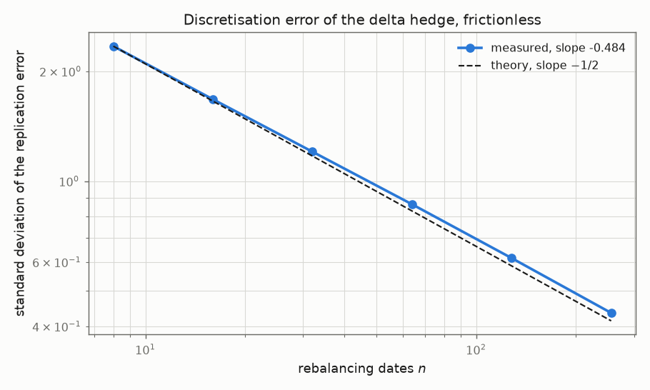
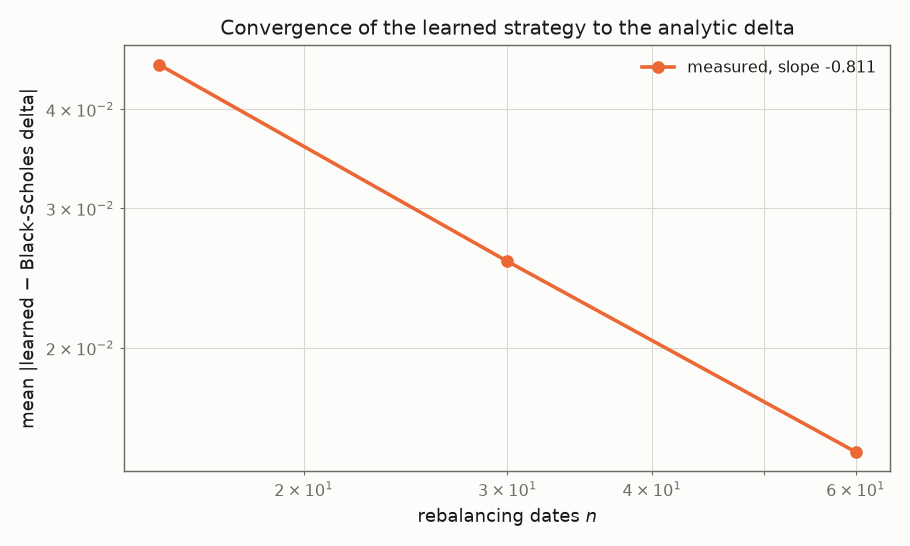
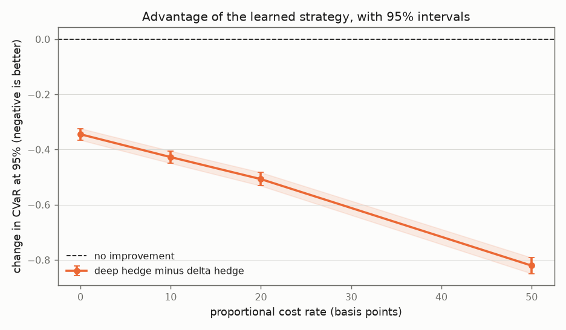

# Deep hedging under transaction costs: study output

Generated 2026-09-26 13:08 (full configuration).

Option: European call, strike 100, spot 100, maturity 1 year, Black-Scholes volatility 0.2. Rates and carry are zero throughout. Paths are simulated under the pricing measure. `+/-` is one Monte Carlo standard error.

## 1. Discretisation error of the delta hedge

*Hypothesis: frictionless, the replication error of the delta hedge decays like n^(-1/2) in the number of rebalancing dates.*

| n | std of replication error | mean error |
|---|---|---|
| 8 | 2.34247 | -0.00203 +/- 0.00741 |
| 16 | 1.67523 | -0.00412 +/- 0.00530 |
| 32 | 1.20342 | +0.00283 +/- 0.00381 |
| 64 | 0.86380 | -0.00402 +/- 0.00273 |
| 128 | 0.61523 | -0.00067 +/- 0.00195 |
| 256 | 0.43526 | +0.00082 +/- 0.00138 |

**Fitted log-log slope -0.4844, against the theoretical -0.5.** The mean error is zero within Monte Carlo error at every n, as it must be: the hedging gain is a martingale increment sum, so the delta hedge is unbiased and only its dispersion is at stake.



## 2. Does the network recover the Black-Scholes delta?

*Hypothesis: with zero costs, refining the rebalancing grid drives the learned position to the analytic delta. The network is never shown a delta during training, so agreement is a recovered theorem.*

| n | mean abs dev | median | p95 | p99 | max | learned risk | delta risk |
|---|---|---|---|---|---|---|---|
| 15 | 0.0455 | 0.0393 | 0.1052 | 0.1608 | 0.2242 | 9.7645 +/- 0.0344 | 11.1696 +/- 0.1509 |
| 30 | 0.0257 | 0.0203 | 0.0625 | 0.1335 | 0.3415 | 8.8646 +/- 0.0097 | 9.0750 +/- 0.0282 |
| 60 | 0.0148 | 0.0110 | 0.0368 | 0.0948 | 0.3589 | 8.4352 +/- 0.0055 | 8.4525 +/- 0.0095 |

**The deviation falls at rate n^(-0.811).**

The delta hedge is a strategy the network is able to represent, so the learned risk has to come out at or below it. A learned risk above it would mean the optimisation had not converged, and could not mean the theory was wrong, so the check is reported here and not asserted:

> Converged at every n: the learned risk came out at or below the delta hedge's throughout, within three standard errors.




## 3. Architecture: shared weights against one network per date

*Hypothesis: a single network with time to maturity as an input matches n per-date networks, at a fraction of the parameters.*

At 60 rebalancing dates and a cost rate of 20 basis points:

| strategy | parameters | risk | turnover |
|---|---|---|---|
| shared weights | 1217 | 9.0901 +/- 0.0053 | 301.68 +/- 0.26 |
| one network per date | 71100 | 9.0982 +/- 0.0067 | 288.94 +/- 0.24 |
| delta hedge |: | 9.2731 +/- 0.0128 | 351.52 +/- 0.34 |

Paired difference (per-date minus shared): 0.0081 +/- 0.0040.

## 4. Indifference price as the risk aversion vanishes

*Hypothesis: with the entropic measure and zero costs, the indifference price tends to the Black-Scholes price as lambda -> 0.*

| lambda | indifference price | minus Black-Scholes |
|---|---|---|
| 0.02 | 7.9756 +/- 0.0026 | +0.0101 |
| 0.05 | 7.9899 +/- 0.0023 | +0.0244 |
| 0.1 | 8.0184 +/- 0.0024 | +0.0529 |
| 0.2 | 8.0703 +/- 0.0023 | +0.1047 |
| 0.4 | 8.1576 +/- 0.0023 | +0.1920 |

Black-Scholes price **7.9656**; linear fit in lambda gives intercept **7.9684** (error +0.0028) and slope 0.4805. The slope is half the variance of the unhedgeable residual, so it is a second measurement over a nuisance parameter.


## 5. The result: hedging with costs in the objective

*Hypothesis: with a positive cost rate the learned strategy attains a strictly lower risk than the delta hedge, and does so by trading less.*

### entropic risk, lambda = 1

Trained for 40 epochs at a batch size of 4096 at each cost rate, i.e. 1,960 gradient steps.

| cost (bp) | delta risk | deep risk | difference (paired) | delta turnover | deep turnover |
|---|---|---|---|---|---|
| 0 | 9.0750 +/- 0.0282 | 8.9033 +/- 0.0107 | -0.1718 +/- 0.0252 | 278.7 | 266.5 |
| 5 | 9.2474 +/- 0.0292 | 9.0357 +/- 0.0106 | -0.2118 +/- 0.0263 | 278.7 | 262.5 |
| 10 | 9.4220 +/- 0.0302 | 9.1725 +/- 0.0107 | -0.2494 +/- 0.0274 | 278.7 | 258.9 |
| 20 | 9.7771 +/- 0.0324 | 9.4377 +/- 0.0109 | -0.3394 +/- 0.0299 | 278.7 | 251.8 |
| 50 | 10.8884 +/- 0.0393 | 10.2171 +/- 0.0115 | -0.6713 +/- 0.0377 | 278.7 | 239.9 |
| 100 | 12.8713 +/- 0.0529 | 11.4096 +/- 0.0117 | -1.4617 +/- 0.0518 | 278.7 | 223.9 |


### CVaR at 95%

Trained for 180 epochs at a batch size of 2048 at each cost rate, i.e. 17,640 gradient steps.

| cost (bp) | delta risk | deep risk | difference (paired) | delta turnover | deep turnover |
|---|---|---|---|---|---|
| 0 | 10.8525 +/- 0.0172 | 10.5079 +/- 0.0114 | -0.3446 +/- 0.0107 | 278.7 | 264.1 |
| 10 | 11.2157 +/- 0.0176 | 10.7883 +/- 0.0115 | -0.4274 +/- 0.0113 | 278.7 | 259.7 |
| 20 | 11.5840 +/- 0.0180 | 11.0767 +/- 0.0115 | -0.5073 +/- 0.0123 | 278.7 | 254.2 |
| 50 | 12.7139 +/- 0.0192 | 11.8931 +/- 0.0117 | -0.8208 +/- 0.0147 | 278.7 | 241.4 |





## 6. Heston calibrated to a real surface

Surface: Deribit BTC, forward 84,012 USD, 249 quotes, 6 to 181 days.

```
v0=0.0915  kappa=20.000  theta=0.1761  xi=3.894  rho=-0.107
implied-vol RMSE 2.15 vol points, max |error| 12.73 vol points, over 249 quotes
Feller 2*kappa*theta - xi^2 = -8.1189 (VIOLATED)
```

All 8 starting points were tried; the spread of the objective across the local optima found was 1.630e-12.


## 7. Hedging under the calibrated Heston model

*Hypothesis: the same advantage appears under stochastic volatility, and it is not merely the classical minimum-variance correction in disguise.*

At-the-money call, 30 days, 30 rebalancing dates, entropic risk with lambda = 1. Feller 2*kappa*theta - xi^2 = -8.1189 (violated); the simulated variance sits at exactly zero on 7.32% of observation dates.

At that rate the zero boundary is not a corner case, and the naive Euler scheme would produce NaN on most paths: see `tests/test_simulate.py::test_naive_euler_variance_scheme_produces_nan`, which measures it. Full truncation is doing real work here.

| cost (bp) | model delta | min-variance delta | deep hedge | deep vs model | deep vs min-var | deep turnover | delta turnover |
|---|---|---|---|---|---|---|---|
| 0 | 10.3330 +/- 0.7727 | 10.2318 +/- 0.7042 | 9.0667 +/- 0.3778 | -1.2663 +/- 0.4989 | -1.1651 +/- 0.4371 | 186.8 | 268.6 |
| 10 | 10.6997 +/- 0.7573 | 10.6023 +/- 0.6878 | 9.3312 +/- 0.3476 | -1.3685 +/- 0.5833 | -1.2710 +/- 0.5216 | 179.0 | 268.6 |
| 50 | 12.2044 +/- 0.6823 | 12.1263 +/- 0.6143 | 10.4220 +/- 0.3598 | -1.7824 +/- 0.4848 | -1.7042 +/- 0.4332 | 167.4 | 268.6 |

Total run time 35.3 minutes.

